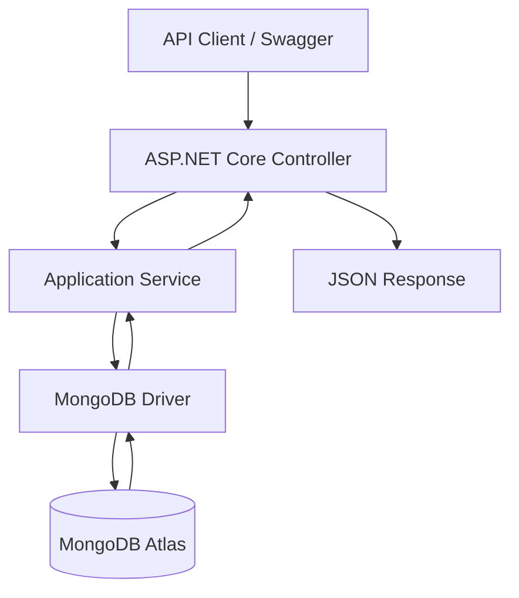

# CommBank rSERVER — .NET Backend Enhancement


## Overview

**CommBank rSERVER** is an existing C#/.NET backend for a financial management application. It provides REST API functionality for users, accounts, savings goals, transactions, and tags.

This repository contains my implementation of a backend enhancement completed as part of a **Forage Software Engineering Virtual Experience**.

The assignment involved configuring the existing application, establishing a MongoDB Atlas connection, populating a development database, extending the Goal model with an optional icon property, and verifying that the updated REST API returns the new field correctly.

The enhancement was implemented and tested using a working MongoDB Atlas development environment.

### Project highlights

- Extended the existing C# Goal model with an optional icon property.
- Configured MongoDB Atlas and imported 25 documents across five collections.
- Verified live database queries through the ASP.NET Core API.
- Returned four savings goals with non-null icon values.
- Achieved HTTP `200 OK` for the tested Goals endpoint.
- Passed all 11 existing automated tests.
- Preserved existing goal attributes and compatibility with records without icons.
- Updated Git tracking to exclude the local secrets file from future commits.

## 1. Technologies and Tools

| Technology | Purpose |
|---|---|
| C# | Backend development |
| ASP.NET Core | REST API implementation |
| .NET 6 | Existing application target framework |
| .NET SDK 10.0.402 | Local development and compilation |
| MongoDB Atlas | Cloud-hosted database |
| MongoDB.Driver 2.18.0 | Existing MongoDB integration |
| MongoDB Compass | Database inspection and JSON imports |
| Swagger / OpenAPI | API exploration and manual testing |
| xUnit | Automated testing |
| Git | Source control |
| GitHub | Repository hosting |
| Visual Studio Code | Development environment |
| PowerShell | Local build and execution |

The original project targets `.NET 6`. During testing, runtime roll-forward was used to run the application with a newer installed .NET runtime.

## 2. Application Architecture

The application uses an ASP.NET Core backend organized around models, services, and controllers.

### Main components

| Component | Responsibility |
|---|---|
| Controllers | Expose HTTP endpoints |
| Services | Handle application operations and database queries |
| Models | Represent application data |
| MongoDB.Driver | Provides database access |
| MongoDB Atlas | Persists application documents |

### Request flow



### Relevant repository structure

```text
CommBank-Server/
|
|-- CommBank-Server/
|   |-- Controllers/
|   |-- Models/
|   |   |-- Goal.cs
|   |   |-- Account.cs
|   |   |-- Transaction.cs
|   |   |-- Tag.cs
|   |   |-- User.cs
|   |
|   |-- Services/
|   |   |-- GoalService.cs
|   |   |-- AccountService.cs
|   |   |-- TransactionsService.cs
|   |   |-- TagsService.cs
|   |   |-- UsersService.cs
|   |
|   |-- Program.cs
|   |-- CommBank.csproj
|   |-- appsettings.json
|   |-- appsettings.Development.json
|   |
|   |-- Secrets.json
|       (local configuration; ignored by Git)
|
|-- CommBank.Tests/
|   |-- CommBank.Tests.csproj
|
|-- Server.sln
|-- .gitignore
|-- README.md
```

The tree is a simplified representation of the relevant project components.

## 3. Task Requirements

The task required modifying the existing .NET backend to support icons for savings goals.

The main requirements were:

1. Fork and clone the existing rSERVER application.
2. Configure a MongoDB Atlas development cluster.
3. Create a database user.
4. Establish an application-to-database connection.
5. Seed the MongoDB database with the provided JSON records.
6. Verify the original API response.
7. Extend the Goal model with an optional public icon field of type string.
8. Test the updated endpoint.
9. Save a successful JSON API response.
10. Share the implementation using Git.

### Original limitation

The original Goal model supported information such as:

- Goal name
- Target amount
- Target date
- Current balance
- Creation date
- Associated transactions
- Associated tags
- User identifier

However, it did not include an icon field.

The enhancement addresses this limitation while preserving the existing model structure.

## 4. Implemented Feature — Optional Goal Icons

### Updated Goal model

The main source-code modification was made in:

`CommBank-Server/Models/Goal.cs`

The added property is:

```csharp
public string? Icon { get; set; }
```

### Updated C# model

```csharp
using MongoDB.Bson;
using MongoDB.Bson.Serialization.Attributes;

namespace CommBank.Models;

public class Goal
{
    [BsonId]
    [BsonRepresentation(BsonType.ObjectId)]
    public string? Id { get; set; }

    public string? Name { get; set; }

    public UInt64 TargetAmount { get; set; } = 0;

    public DateTime TargetDate { get; set; }

    public double Balance { get; set; } = 0.00;

    public DateTime Created { get; set; } = DateTime.Now;

    [BsonRepresentation(BsonType.ObjectId)]
    public List<string>? TransactionIds { get; set; }

    [BsonRepresentation(BsonType.ObjectId)]
    public List<string>? TagIds { get; set; }

    public string? Icon { get; set; }

    [BsonRepresentation(BsonType.ObjectId)]
    public string? UserId { get; set; }
}
```

### Why the property is nullable

Using `string?` allows goals without an icon to remain valid.

For an existing MongoDB document without an icon, the API can return:

```json
{
  "name": "House Down Payment",
  "icon": null
}
```

When an icon value is present, the API can return:

```json
{
  "name": "House Down Payment",
  "icon": "home"
}
```

This maintains backward compatibility with previously stored goal documents.

### BSON and JSON serialization

The C# property is named `Icon`.

In the tested MongoDB documents, the field was stored using:

```text
Icon: "home"
```

The ASP.NET Core API serialized this property in its response as:

```json
{
  "icon": "home"
}
```

The implementation supports string icon identifiers. Rendering graphical icons is a frontend responsibility and was outside the scope of this backend task.

## 5. MongoDB Atlas Configuration

The development environment was configured with MongoDB Atlas.

| Configuration | Development value |
|---|---|
| Atlas project | CommBank-rSERVER |
| Cluster | Cluster0 |
| Database | CommBank |
| Database user | commbank_dev |
| Authentication | SCRAM |
| Database privilege | readWrite@CommBank |
| Cloud provider | AWS |
| Deployment region | Hong Kong |
| Cluster tier | Free |

The Atlas database user was configured with permissions restricted to the application database rather than read/write permissions across every database.

### Connection configuration

The backend loads a local configuration file named `Secrets.json`.

The relevant code in `Program.cs` is:

```csharp
builder.Configuration
    .SetBasePath(Directory.GetCurrentDirectory())
    .AddJsonFile("Secrets.json");

var mongoClient = new MongoClient(
    builder.Configuration.GetConnectionString("CommBank")
);

var mongoDatabase = mongoClient.GetDatabase("CommBank");
```

The configuration requires a `ConnectionStrings:CommBank` entry.

### Local Secrets.json format

Create the file inside the `CommBank-Server` application directory:

```json
{
  "ConnectionStrings": {
    "CommBank": "YOUR_PRIVATE_MONGODB_CONNECTION_STRING"
  }
}
```

Replace the example value with a valid connection URI supplied by MongoDB Atlas.

**Never publish the real connection URI or database password.**

The application should be launched from its project directory because its startup code resolves `Secrets.json` relative to the current working directory.

## 6. Database Seeding

The development database was populated using the sample data supplied for the Forage simulation.

Source:

[CommBank Program — Seed Data](https://github.com/fencer-so/commbank-program/tree/master/data)

### Imported collections

| Collection | Records imported |
|---|---:|
| Accounts | 1 |
| Goals | 4 |
| Tags | 5 |
| Transactions | 14 |
| Users | 1 |
| **Total** | **25** |

All five collections were imported into the `CommBank` database.

### Data integrity checks

The MongoDB Compass verification showed that imported documents preserved important BSON types, including:

- `ObjectId` identifiers
- Date values represented as `ISODate`
- Numeric fields
- Arrays
- Nullable references

The API was also able to deserialize and return the seeded Goal documents successfully.

### Example goal dataset

The seeded database contained four goals:

| Goal | Target Amount | Initial Balance |
|---|---:|---:|
| House Down Payment | 100,000 | 73,501.82 |
| Tesla Model Y | 60,000 | 43,840.02 |
| Trip to London | 3,500 | 753.89 |
| Trip to NYC | 800 | 0 |

The amounts are taken from the supplied development data; a currency is not specified in the records.

## 7. Icon Test Data

After adding the optional Icon property, the development Goal documents were updated with test icon identifiers.

| Goal | Icon value | Purpose |
|---|---|---|
| House Down Payment | `home` | Housing goal |
| Tesla Model Y | `car` | Vehicle goal |
| Trip to London | `flight` | Travel goal |
| Trip to NYC | `flight` | Travel goal |

These identifiers are sample test values, not a required enumeration imposed by the backend.

All four values were successfully returned by the application in the JSON API response.

## 8. REST API Verification

### Endpoint

```http
GET http://localhost:5000/api/Goal
```

This endpoint retrieves the goal records from MongoDB.

### Baseline test

Before adding the Icon property, the endpoint successfully returned the seeded goal records without an icon field.

Expected baseline behavior:

```json
{
  "name": "House Down Payment",
  "targetAmount": 100000,
  "balance": 73501.82
}
```

This is an abbreviated example of the original response.

### Test after adding the Icon property

After rebuilding and restarting the application, Swagger displayed the updated Goal schema:

```text
icon
  type: string
  nullable: true
```

Existing goal documents initially returned:

```json
{
  "name": "House Down Payment",
  "icon": null
}
```

After assigning icon values through MongoDB Compass, the endpoint returned non-null icon strings.

### Actual tested response example

The following is an excerpt from the successful API response:

```json
{
  "id": "62a3f587102e921da1253d32",
  "name": "House Down Payment",
  "targetAmount": 100000,
  "targetDate": "2025-01-08T05:00:00Z",
  "balance": 73501.82,
  "created": "2022-06-11T01:53:10.857Z",
  "transactionIds": null,
  "tagIds": null,
  "icon": "home",
  "userId": "62a29c15f4605c4c9fa7f306"
}
```

### Additional tested responses

**Tesla Model Y**

```json
{
  "name": "Tesla Model Y",
  "targetAmount": 60000,
  "balance": 43840.02,
  "icon": "car"
}
```

**Trip to London**

```json
{
  "name": "Trip to London",
  "targetAmount": 3500,
  "balance": 753.89,
  "icon": "flight"
}
```

**Trip to NYC**

```json
{
  "name": "Trip to NYC",
  "targetAmount": 800,
  "balance": 0,
  "icon": "flight"
}
```

These three examples are abbreviated excerpts retaining the values observed in the final response.

### API verification results

| Verification | Result |
|---|---|
| Endpoint | GET /api/Goal |
| HTTP status | 200 OK |
| Response format | application/json |
| Goal records returned | 4 |
| Goals containing `icon` | 4 |
| Non-null icon values | 4 |
| Existing properties retained | Yes |
| Database read operation | Successful |
| JSON serialization | Successful |

## 9. Automated Testing

The original solution contains an xUnit test project.

The test suite was executed after introducing the Icon property.

### Test command

```bash
dotnet test Server.sln --no-build
```

### Verified test results

```text
CommBank.Tests test net6.0 succeeded

Test summary:
total:     11
failed:    0
succeeded: 11
skipped:   0
duration:  3.5s
```

### Build verification

```text
CommBank net6.0 succeeded
CommBank.Tests net6.0 succeeded

Build succeeded
```

All 11 existing automated tests passed.

The icon enhancement was also tested manually using Swagger and actual MongoDB records. The passing existing tests and manual API checks do not imply that new dedicated icon-specific unit tests were added.

## 10. Installation and Running Locally

### Prerequisites

- Git
- Visual Studio Code or Visual Studio
- .NET SDK
- A compatible .NET runtime
- MongoDB Atlas account
- MongoDB database access credentials
- Network access to the configured MongoDB deployment
- MongoDB Compass (recommended for inspecting or importing data)

### Step 1 — Clone the repository

```bash
git clone https://github.com/nmlandvo3-bit/CommBank-Server.git
cd CommBank-Server
```

### Step 2 — Configure MongoDB

Create a MongoDB Atlas cluster and a database named:

```text
CommBank
```

Create a database user with appropriate permissions.

For the development environment, a database-scoped `readWrite` role was used.

### Step 3 — Create the local configuration

Create `CommBank-Server/Secrets.json`.

Add a private MongoDB connection string using the format shown in the configuration section.

Do not commit credentials to source control.

### Step 4 — Restore dependencies

```bash
dotnet restore Server.sln
```

### Step 5 — Build

```bash
dotnet build Server.sln
```

### Step 6 — Run tests

```bash
dotnet test Server.sln
```

### Step 7 — Start the backend

For the verified Windows development setup, PowerShell commands were:

```powershell
cd .\CommBank-Server

$env:ASPNETCORE_ENVIRONMENT = "Development"
$env:DOTNET_ROLL_FORWARD = "Major"

dotnet run --no-launch-profile
```

The application was tested at:

```text
http://localhost:5000
```

If the application uses a different port, use the address shown in the terminal output.

### Step 8 — Open Swagger

```text
http://localhost:5000/swagger
```

Select the Goal controller and execute:

```http
GET /api/Goal
```

### Step 9 — Verify the response

A populated development database should return the seeded goal objects.

To reproduce the demonstrated response with non-null icons, ensure the Goal documents contain their corresponding `Icon` values.

## 11. Troubleshooting

### MongoDB authentication failure

During setup, the backend initially returned:

```text
MongoAuthenticationException:
Unable to authenticate using sasl protocol mechanism SCRAM-SHA-1.

bad auth: authentication failed
```

The issue was resolved by correcting the MongoDB database credentials in the private connection string.

When troubleshooting similar errors, verify:

- Database username
- Database password
- Connection string format
- Authentication database
- Password URI encoding
- MongoDB Atlas network access

Avoid printing credentials in terminal logs or screenshots.

### API returns an empty array

```json
[]
```

An empty result can mean that no goals exist in the collection being queried.

Check that:

- The database is named `CommBank`.
- The collection is named `Goals`.
- The development dataset has been imported.
- The backend connects to the intended deployment.

### Build fails because the executable is locked

A build initially failed with errors:

```text
MSB3027
MSB3021
```

The cause was an existing rSERVER process holding the executable open.

The issue was resolved by stopping the running backend before rebuilding.

### The icon returns null

If the API returns:

```json
{
  "icon": null
}
```

the model property is available but that record may not contain a stored icon value.

Populate the `Icon` field in the development document and repeat the API request.

## 12. Security Considerations

### Secrets management

The original repository included a tracked `Secrets.json` file.

For this enhancement:

- A Git ignore rule was added for `Secrets.json`.
- The file was removed from Git's current tracking index.
- The local file was retained for development.
- The updated repository no longer tracks the file in the latest commit.

**Important:** Removing a file from the latest Git version does not erase it from earlier commits. Historical repository content should be reviewed before using the code in sensitive environments, and any exposed credentials must be rotated.

### Database privileges

The development database user was configured with the `readWrite` role on the `CommBank` database.

This is preferable to unnecessarily granting write access across all databases.

### Dependency warnings

The verified build generated the following warnings:

| Warning | Description |
|---|---|
| NETSDK1138 | .NET 6 is no longer supported |
| NU1903 | MongoDB.Driver 2.18.0 has a reported high-severity vulnerability |

These warnings did not prevent the feature from compiling or passing the existing tests.

However, the application should not be considered production-ready solely because those tests passed.

Before production use, review and upgrade affected dependencies, reassess compatibility, and carry out additional security testing.

## 13. Version Control

The implementation was committed to GitHub with the following commit:

**Commit:** `995fb33`

**Message:**

```text
Add optional icon support to Goal model and protect local secrets
```

The commit includes:

- The optional Icon field in `Goal.cs`.
- The Git ignore rule for local secrets.
- Removal of the tracked Secrets.json file from the current repository tree.

[View implementation commit](https://github.com/nmlandvo3-bit/CommBank-Server/commit/995fb33)

The working tree was confirmed clean after the successful push.

## 14. Engineering Skills Demonstrated

This project demonstrates practical experience in:

- C# backend development
- ASP.NET Core REST APIs
- Modifying existing application models
- MongoDB Atlas configuration
- MongoDB BSON serialization
- Database seeding and verification
- API documentation and testing
- Diagnosing authentication failures
- Debugging .NET build errors
- Automated regression testing
- Git version control
- Secure handling of local configuration
- Maintaining backward compatibility

## 15. Scope and Attribution

This repository is based on the original rSERVER project:

[Original CommBank Server — fencer-so](https://github.com/fencer-so/commbank-server)

The starter architecture, existing application functionality, and original automated tests were provided by the source project.

### Work completed in this simulation

My work involved:

- Cloning and configuring the project.
- Establishing and debugging the MongoDB Atlas development environment.
- Importing and verifying the supplied development records.
- Implementing the optional `Icon` property.
- Testing its serialization using the live API.
- Running the existing automated tests.
- Updating Git tracking for the local secrets file.
- Committing and pushing the implementation.

This is an independent educational project completed through the **Forage Software Engineering Virtual Experience**. It does not represent production engineering work performed for Commonwealth Bank.

## 16. Author

**Mlandvo Welcome Nkambule**

Computer Science | Software Engineering | AI/ML

GitHub: [nmlandvo3-bit](https://github.com/nmlandvo3-bit)

---

**Project status:** Feature implemented and verified in the development environment.

**Completed:** October 2026.